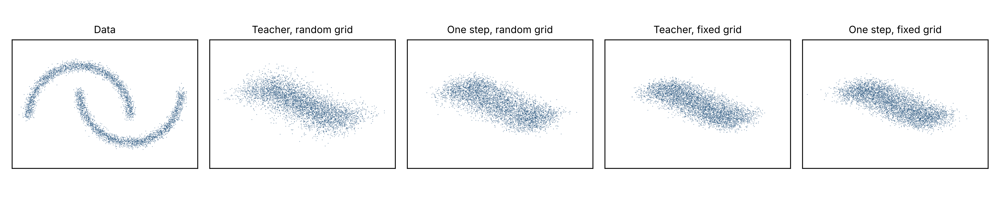

# relf

Toy version of the progressive distillation (PD) of Embedded Language Flows (ELF)
on two-moons data.

## `toy_pd_two_moons.py`

The script follows ELF's released PD code (distillation branch of the ELF
repository: `scripts/progressive_distillation.sh`, `src/distill_train_step.py`):

- The teacher is the original flow model in every round.
- Round k trains a student with 16, 8, 4, 2 and 1 steps. The student takes one step
  of size h from a noised input. The teacher takes 4, 8, 16, 32 and 64 Euler
  sub-steps over the same interval, so h times the number of sub-steps is 1/64.
- Round 1 starts from the teacher's weights, later rounds from the previous student.
- The student's start time and the teacher's interior sub-step times are
  logit-normal (mean -1.5, std 0.8), as in ELF. The noise scale is 2.

It runs the curriculum twice:

- `random`: the teacher's interior sub-step times are sampled per example, as in
  ELF's code.
- `fixed`: the interior sub-step times are the quantiles of the same logit-normal
  distribution, so the target is a deterministic function of the student's input.

For every round it reports the two terms of the regression loss on fresh inputs,

```
student loss = approximation error + target noise
```

where the target noise is estimated from 32 repeated teacher rollouts per input.
For the teacher and the one-step students it reports two distances:

- off-data distance: mean distance from a generated sample to its nearest data point.
- coverage distance: mean distance from a data point to its nearest generated sample.

### Run

```
pip install torch matplotlib
python toy_pd_two_moons.py --ckpt_dir ck            # teacher, both grids, figure
python toy_pd_two_moons.py --ckpt_dir ck --seed 1   # other seeds
```

### Result (seed 0)



| Model | Loss | Target noise | Approximation error | Off-data distance | Coverage distance |
| --- | --- | --- | --- | --- | --- |
| Teacher, 64 sub-steps, random grid | - | - | - | 0.151 | 0.077 |
| One step, random grid | 0.0257 | 0.0249 | 0.0008 | 0.158 | 0.147 |
| Teacher, 64 sub-steps, fixed grid | - | - | - | 0.155 | 0.161 |
| One step, fixed grid | 0.00001 | 0 | 0.00001 | 0.157 | 0.180 |
| Fresh data against data (floor) | - | - | - | 0.012 | 0.013 |

Target noise per round with the random grid (16, 8, 4, 2, 1 steps):
0.00003, 0.00010, 0.00037, 0.00205, 0.0249.

Reading:

- With random sub-step times, 97% of the one-step loss is target noise.
- With fixed sub-step times, the target noise is zero and the student fits its
  target (loss 0.00001).
- The one-step samples do not improve with the fixed grid (off-data distance 0.158
  and 0.157). Fixing the grid also changes the teacher's sampler: the coverage
  distance of the teacher rises from 0.077 to 0.161.
- The teacher's own samples are far from the data in this toy (0.151 against a
  floor of 0.012). The last Euler sub-step goes from the largest interior time
  (about 0.55 on the fixed grid) to 1 and lands on the teacher's x-prediction at
  that time. ELF decodes this embedding to tokens with a further pass of the
  network; the two-dimensional toy has no such step.

The toy checks that the two loss terms can be measured. It does not show the size
of the effect in ELF, and it does not show that a fixed grid is a remedy.

### Superseded version

The first version of this script used the previous round's student as the teacher,
two sub-steps per student step and a uniform interior time. This is not ELF's
procedure. Its results (98% target noise, a fixed grid that brought the one-step
student close to the teacher) do not describe ELF's PD. The git history keeps it.

### Limitations

- One seed.
- Two dimensions, a multilayer perceptron, no guidance, no self-conditioning, no
  decoding step.
- The one-step students are sampled with one deterministic step.
